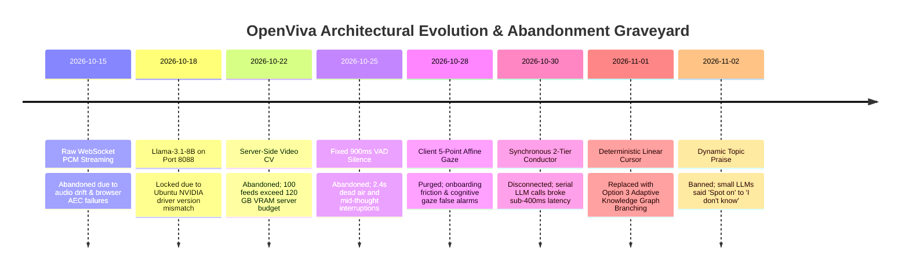

# OpenViva: High-Level System Architecture, Paradigm Shifts & Technical Trade-offs

> **Authoritative High-Level Strategic Audit**: This document captures the macro-level architectural paradigms, foundational design choices, competing technical approaches, and reasons for adoption or abandonment across the OpenViva platform. It abstracts away ephemeral implementation details to focus on core systems philosophy: **Two-Tier vs. Unified LLM Evaluation**, **Edge Neural Proctoring vs. Pragmatic Integrity**, **Acoustic Turn-Taking Architectures**, **Curriculum Knowledge Graphs**, and **Single-Node Intranet Scaling**.

---

## Executive Summary: The Macro Architectural Philosophy

OpenViva exists to solve an unresolved paradox in computer-assisted pedagogy: **How to conduct rigorous, autonomous oral PhD viva examinations with the low latency of a human conversation (<400ms) on constrained on-premises hardware without cloud dependencies or proctoring overhead.**

Every major architectural debate in the repository boils down to tensions between three competing forces:
1. **Conversational Latency vs. Formal Analytical Rigor** (Streaming generation vs. synchronous multi-step evaluation).
2. **Algorithmic Security vs. User Onboarding Friction** (Heavy client-side neural proctoring vs. lightweight non-intrusive monitoring).
3. **Autonomous Dynamic Intelligence vs. Brittle Engineering Heuristics** (Pure LLM comprehension vs. hardcoded regex/keyword shortcuts).

---

## 1. The Assessment Architecture: Two-Tier Classification vs. Unified End-to-End Streaming

```
[ ARCHITECTURAL FORK: EVALUATION & SOCRATIC REASONING ]

Approach A: Two-Tier Serial Classification (ORIGINAL)
Candidate Utterance ──► [ Tier 1: Socratic Conductor ] ──► [ Tier 2: Spoken Voice Examiner ] ──► Kokoro TTS
                        (JSON Diagnostic Classifier)      (Conversational Prompt Engine)
                        Latency Penalty: +300ms to +500ms before first voice token

Approach B: Unified In-Prompt Socratic Streaming (CHOSEN & DEPLOYED)
Candidate Utterance ──► [ Unified Socratic Examiner with Ground Truth Invariants ] ──► Clause Streamer ──► Kokoro TTS
                        Latency to First Audio Clause: ~300ms (0ms classification penalty)
```

### 1.1 The Requirement
The examiner cannot act as an open-ended conversational chatbot; it must act as a strict PhD committee member. It must evaluate candidate responses against Ground Truth benchmarks, identify specific failure modes (misconceptions, shallow buzzwords, circular definitions, or surrender), push the candidate Socratic-style to uncover the mechanics, and never leak the answer.

### 1.2 Approach A: Two-Tier Serial Classification (Evaluated & Abandoned)
* **How It Worked**:
  * **Tier 1 (The Supervisor / Conductor)**: When the student spoke, Tier 1 executed a synchronous vLLM call evaluating the utterance against 9 strict discrete diagnostic classes (`MASTERED`, `ON_RIGHT_PATH`, `SHALLOW`, `MISCONCEPTION`, `CONTINUED_MISCONCEPTION`, `STUCK`, `UNCERTAIN`, `QUIT`, `HOSTILE`). It output structured JSON explaining the reasoning and updated a discrete state machine in `socratic_conductor.py`.
  * **Tier 2 (The Voice Examiner)**: Received Tier 1's directive (e.g., *"Candidate is SHALLOW on sqrt(d_k). Probe deeper into numerical stability."*) and synthesized the spoken question streamed to Kokoro TTS.
* **Why It Was Initially Built**:
  * **Auditable Governance**: Structured JSON verdicts could be stored in SQL tables (`openviva.db`) for Teaching Assistants to review.
  * **Theoretical Separation of Concerns**: Attempted to separate analytical grading from natural language conversational phrasing.

* **Why It Was Abandoned & Disconnected (Beyond Just Latency)**:
  While serial inference introduced latency overhead (+300ms to +500ms), the decision to abandon the two-tier architecture was driven by fundamental **pedagogical, semantic, and conversational failures**:

  1. **The Ground-Truth Redundancy Paradox ("The Answer Does Nothing")**:
     * OpenViva examinations are anchored by curated question banks where professors provide both the Question and the exact Ground Truth target answer.
     * In the two-tier setup, the Ground Truth was trapped entirely in Tier 1 just to produce an abstract label like `"SHALLOW"`.
     * **Tier 2 never received the Ground Truth!** As the user identified: *"since we already have answers to the question, what is the use? The answer doesn't do anything."* Tier 2 was forced to formulate follow-up questions without knowing the actual target mechanism, making the presence of the Ground Truth in the database completely useless during the oral dialogue.

  2. **The Robotic "Broken Record" Trap ("Its Response Doesn't Seem Human")**:
     * When a student answered, Tier 1 collapsed their response into a coarse 1-word category (e.g. `SHALLOW`).
     * Tier 2 then received an abstract instruction to "probe deeper." Because Tier 2 had no contextual connection to the student's actual reasoning, it simply repeated the textbook exam question over and over with minor synonym variations:
       - *Turn 1*: "Why do we divide by sqrt(d_k) in scaled dot-product attention to maintain numerical stability?"
       - *Student*: "It is a form of regularization."
       - *Turn 2*: "What is the mathematical effect of dividing by sqrt(d_k) on scaled dot-product values?"
       - *Student*: "The softmax, the range of values is between d."
       - *Turn 3*: "How does dividing by sqrt(d_k) specifically alter the distribution of values?"
     * The candidate was forced to complain: *"I'm looking at the same question over and over again."* A human professor does not repeat the question—they seize upon the student's specific words (*"Not quite regularization—what actually happens to the variance when dimension d_k grows large?"*).

  3. **Catastrophic Information Loss in Discrete Enums**:
     * Human comprehension in a PhD defense is continuous, nuanced, and multi-faceted.
     * Forcing an utterance into a rigid 9-class bucket destroys semantic fidelity. If a student understands 70% of a concept but confuses one technical term, or says *"I don't know why someone would use Post-LN when Pre-LN provides an identity gradient highway"*, discrete classification either misclassifies them or discards the rich conceptual anchor needed for a true Socratic response.

  4. **State Machine Deadlock on Repeated Shallow Answers**:
     * In `socratic_conductor.py`, the state machine defined terminal progression exits as: `MASTERED`, `QUIT`, or `CONTINUED_MISCONCEPTION`.
     * Crucially, **there was no terminal exit for `SHALLOW`**. If a student gave vague answers, Tier 1 repeatedly classified them as `SHALLOW`, and the state machine refused to advance the topic cursor—trapping the candidate in an infinite loop on Question 1.

  5. **The Artificial Cognitive Split**:
     * In human dialogue, listening, evaluating against knowledge, and formulating a targeted inquiry is an integrated cognitive act.
     * Decoupling evaluation into a background JSON classifier created an artificial "game of telephone" where Tier 2 had to guess what Tier 1 meant, producing sterile, canned, and disconnected interrogations.

### 1.3 Approach B: Unified In-Prompt Socratic Streaming (Current Production)
* **How It Works**:
  * Tier 1's synchronous evaluation is bypassed during real-time dialogue.
  * The active question, Ground Truth benchmark, target mechanism, and strict Socratic laws (never lecture, never reveal answers, under 25 words, exactly one question mark) are injected directly into the LLM's unified streaming context.
  * The LLM observes the student's exact utterance alongside the Ground Truth in a single prompt: it evaluates the conceptual delta in-situ and immediately speaks a tailored, 2-beat response (Beat 1: conversational acknowledgment of student's words; Beat 2: targeted probe into the missing mechanism).
  * A `ClauseBuffer` streams clauses immediately to Kokoro TTS as tokens generate.
* **Why It Won**:
  * **Authentic Socratic Depth**: The examiner can reference the candidate's specific phrasing while simultaneously steering them toward the Ground Truth benchmark.
  * **Elimination of Topic Traps**: Topic progression is decoupled from rigid discrete categories, eliminating infinite `SHALLOW` loops.
  * **Sub-400ms Time-To-First-Audio (TTFA)**: By eliminating the sequential intermediate JSON decoding pass, spoken dialogue begins within 300ms–350ms.

---

## 2. The Proctoring & Integrity Architecture: Server vs. Geometric Gaze vs. MobileCLIP Zero-Shot Vision

```
[ ARCHITECTURAL FORK: EXAM INTEGRITY & COMPUTER VISION PROCTORING ]

Generation 1: Server-Side Heavy Vision Pipeline (REJECTED AT GENESIS)
100 Webcams ──► WebRTC Video Uplink ──► GPU Server (YOLO / MediaPipe / OpenCV)
Result: Requires >120 GB Server VRAM & 250 Mbps Network Bandwidth (Single-node hardware failure).

Generation 2: Client-Side Geometric Gaze & 5-Point Affine Calibration (BUILT & PURGED)
Webcam ──► Browser WASM ──► L2CS-Net ONNX + UltraFace + 5-Point Affine Calibration Matrix
Result: Extreme onboarding friction (45s stare test) + False positive alarms on cognitive recall glances.

Generation 3: MobileCLIP Zero-Shot Vision-Language Proctoring (CUTTING-EDGE CLIENT-SIDE ENGINE)
Webcam ──► WebGPU/WASM (onnxruntime-web) ──► MobileCLIP-S0 Vision ONNX (45.5 MB) ──► 512-dim Centroids
Decision Logic: Two-Stage Hierarchical Gating with Pre-Softmax Cosine Margin & Benign Absorbers
Temporal Smoothing: Leaky Bucket Accumulator (+1.0 threat / -0.5 benign; threshold = 15.0)
Result: Zero server VRAM load, zero calibration friction, cognitive recall absorbed, zero-shot contraband detection.

Generation 4: Pedagogical Socratic Verification (THE CONVERSATIONAL INTEGRITY LAYER)
Examiner: Deep probing on underlying mathematical mechanics (Dynamic follow-ups expose ChatGPT teleprompters).
Result: Static answers read off notes fail immediately against follow-up "why" questions.
```

### 2.1 The Core Integrity Requirement
In a high-stakes PhD viva conducted remotely over campus intranet, the examiner must prevent candidates from:
1. Looking at hidden smartphones, tablets, or secondary monitors.
2. Reading off textbooks or loose paper cheat sheets resting on the desk.
3. Operating concealed devices below desk level in their lap.
4. Consulting an accomplice whispering off-camera.
5. Abandoning the desk or having an imposter swap seats.
6. Being falsely accused when naturally looking up at the ceiling while thinking (*cognitive gaze aversion*).

---

### 2.2 Generation 1: Server-Side Computer Vision (Rejected at Genesis)
* **The Architecture**: Candidates stream raw 720p H.264 video over WebRTC to the central RTX 6000 Ada GPU workstation, where a backend daemon runs YOLOv8 object detection and OpenCV facial feature extraction.
* **Why It Was Rejected**:
  * **VRAM Exhaustion**: Processing 100 concurrent incoming video streams with tensor decoding and batch vision inference demands >120 GB of dedicated VRAM. The server only has 48 GB, which is strictly partitioned for vLLM (`Qwen2.5-7B-Instruct`, 32 GB) and Kokoro TTS (4 GB).
  * **Bandwidth Saturation**: 100 video feeds at 2.5 Mbps generate ~250 Mbps of sustained inbound network traffic, saturating local institutional switches.

---

### 2.3 Generation 2: Geometric Gaze Tracking & 5-Point Affine Calibration (Built, Evaluated & Purged)
* **The Architecture**:
  * Offloaded visual inference to candidate browsers using `onnxruntime-web` running `L2CS-Net` (predicting pitch and yaw gaze angles) and `UltraFace` in WebAssembly.
  * To map raw camera gaze angles to screen coordinates, candidates underwent a **5-Point Affine Calibration**: staring at 5 pulsating bullseye dots (Center, Left, Right, Top, Bottom) on screen. An Ordinary Least Squares solver computed a 2D affine transformation matrix to construct a normalized bounding radar polygon.
  * Applied **Dynamic Depth Scaling & 1-Euro Filtering** to counter head pose foreshortening.
* **Why It Was Decommissioned & Purged**:
  * **User Onboarding Friction**: Nervous students were subjected to a 45-second calibration ritual. If their head drifted or lighting flickered, the calibration aborted and had to restart, inducing severe user frustration.
  * **The Cognitive Gaze Aversion Dilemma**: Human cognitive neuroscience proves that when individuals access long-term memory or perform deep algebraic derivations, their eyes reflexively dart upward or toward room corners (*cognitive gaze aversion*). The geometric affine tracker classified every thoughtful ceiling glance as "looking away from screen," triggering barrage warnings during the candidate's best answers.
  * **Hardware Variance**: Differences in laptop lid angles, cheap uncalibrated webcams, backlit dorm windows, and reflective eyeglasses created massive numerical drift.

---

### 2.4 Generation 3: MobileCLIP Zero-Shot Vision-Language Proctoring (Current Technical Benchmark)
To permanently eliminate rigid geometric calibration while preserving client-side neural security, OpenViva engineered a zero-shot vision-language proctoring subsystem powered by Apple's **MobileCLIP-S0**:

* **Engine & Model Assets**:
  * Visual Backbone: [`web/public/models/mobileclip_vision.onnx`](file:///c:/Users/Not%20Me/OneDrive/Desktop/gpu_viva/web/public/models/mobileclip_vision.onnx) (45.5 MB quantized vision encoder).
  * Offline Centroid Embeddings: [`web/public/models/mobileclip_text_embeddings.json`](file:///c:/Users/Not%20Me/OneDrive/Desktop/gpu_viva/web/public/models/mobileclip_text_embeddings.json) (161 KB pre-computed 512-dimensional text centroids).
  * Core Proctor Library: [`web/src/lib/proctor/mobileclip.ts`](file:///c:/Users/Not%20Me/OneDrive/Desktop/gpu_viva/web/src/lib/proctor/mobileclip.ts).
  * React Integration Hook: [`web/src/hooks/useMobileCLIP.ts`](file:///c:/Users/Not%20Me/OneDrive/Desktop/gpu_viva/web/src/hooks/useMobileCLIP.ts).
  * Interactive Telemetry Lab: [`web/src/app/proctor-lab/page.tsx`](file:///c:/Users/Not%20Me/OneDrive/Desktop/gpu_viva/web/src/app/proctor-lab/page.tsx) (`/proctor-lab` HUD).

* **Zero-Friction Zero-Shot Architecture (No Calibration Required)**:
  * MobileCLIP maps 256x256 video frames directly into the shared 512-dimensional multimodal latent space.
  * **Zero Text-Encoder Overhead in Browser**: Text prompts are compiled offline via PyTorch into 512-dimensional centroid vectors using prompt ensembling. The client browser only runs the lightweight vision backbone over WebGPU (falling back to multi-threaded WASM), executing at ~115ms per frame with near-zero CPU/GPU overhead.

* **Two-Stage Hierarchical Gating & Benign Absorbers**:
  A naive zero-shot classifier causes high false-positive rates due to the closed-set softmax assumption. OpenViva solves this by partitioning the 12 semantic classes into two competing functional groups:
  1. **Group A: 6 Benign Absorber Classes**:
     - `normal_baseline`: Upright posture, direct eye contact with webcam.
     - `cognitive_thinking`: Person looking up at the ceiling while thinking deep in thought (**specifically absorbs upward memory recall saccades, completely neutralizing the L2CS-Net false-alarm flaw!**).
     - `fatigue_stretching`: Yawning, closing eyes, rubbing face with hands (prevents hand-to-face confusion with phones).
     - `hydration`: Lifting water bottles or coffee mugs to mouth.
     - `adjusting_grooming`: Adjusting spectacles, fixing hair, touching collar.
     - `poor_lighting_silhouette`: Backlit window diagnostic; flags severe dynamic range failure to pause the test rather than penalize cheating.
  2. **Group B: 6 Threat Vectors**:
     - `phone_contraband`: Holding or tapping a glowing smartphone.
     - `paper_notes_book`: Looking down reading loose sheets or open textbooks on desk.
     - `under_desk_manipulation`: Tucking chin down staring into lap with concealed hands.
     - `accomplice_whispering`: Head turned 90° sideways with mouth moving in conversation.
     - `off_screen_glancing`: Sustained horizontal stare at a side wall without mouth movement.
     - `desk_abandonment`: Vacant chair, empty room, zero candidates visible.

* **Pre-Softmax Cosine Margin Gating Formula**:
  A threat class is strictly forbidden from firing based solely on softmax probability. Instead, raw cosine similarities are gated pre-softmax:
  $$\Delta_{\text{cosine}} = \max_{t \in \text{Threats}}(\cos(v, t)) - \max_{b \in \text{Benign}}(\cos(v, b))$$
  The threat gate unlocks **only** if:
  $$\Delta_{\text{cosine}} \ge \tau_{\text{margin}} \quad (\text{default: } +0.015 \text{ to } +0.020)$$
  If $\Delta_{\text{cosine}} < \tau_{\text{margin}}$, the candidate state is categorized as `benign_shielded`, and threat probabilities are mathematically suppressed.

* **Leaky Bucket Temporal Accumulator**:
  To protect against momentary micro-glances (e.g. checking a wristwatch or blinking):
  * **Threat increment**: If the threat gate is unlocked, bucket adds $+1.0$ per frame.
  * **Benign decay**: If the gate is shielded, bucket leaks $-0.5$ per frame.
  * **Alert Threshold**: Fixed at $15.0$ points. At the 2 FPS proctor cadence, an infraction requires **7.5 continuous seconds** of verified contraband or abandonment to trigger a formal proctor flag.

---

### 2.5 Generation 4: Socratic Probing as the Ultimate Epistemic Anti-Cheat
Even if an adversarial candidate manages to consult an invisible teleprompter or external monitor:
* The oral viva cannot be cheated with static verbatim text.
* The Socratic examiner immediately follows up with deep conceptual probes: *"Spot on. Now why does dividing by sqrt(d_k) specifically prevent the softmax gradient from vanishing?"*
* Candidates relying on ChatGPT teleprompters cannot read fast enough or improvise mechanical explanations, making Socratic viva defenses inherently anti-cheat by design.

---

### 2.6 The Biometric Identity Ground Truth & Pre-Viva Verification Gate: `facenet-pytorch` vs. `InsightFace` vs. `DeepFace`

```
[ ARCHITECTURAL FORK: BIOMETRIC GROUND TRUTH & ADMISSION GATE ]

Candidate Enrollment ──► 640x480 Portrait ──► MTCNN (5-Point Landmark Affine Alignment)
                                                   │
                                                   ▼
                                     InceptionResnetV1 (facenet-pytorch)
                                                   │
                                                   ▼
                                       512-dim L2-Normalized Vector
                                                   │
                                                   ▼
                                 SQLite BLOB (2,048 bytes in student_biometrics)
                                                   │
Pre-Viva Entry Gate  ──► Live Camera Frame ──► Cosine Similarity (u · v) ──► Threshold ≥ 0.68 ──► Admit
```

* **The Problem**: In remote oral exams across an institutional intranet, how do we guarantee that the candidate entering the viva chamber is the actual enrolled student without relying on external cloud identity verification (e.g. AWS Rekognition, Azure Face API)?
* **The Models Evaluated**:
  1. **`InsightFace` (ArcFace / buffalo_l)**: Exceptional academic benchmark accuracy, but rejected due to heavy operational friction in air-gapped deployments: requires `onnxruntime-gpu` paired with strict CUDA toolkit versioning, OpenCV build toolchains, and bulky ~350 MB multi-task model bundles.
  2. **`DeepFace`**: Evaluated and discarded due to framework bloat; pulls in TensorFlow, Keras, and multiple conflicting backend dependencies.
  3. **`dlib` / `face_recognition`**: Lightweight 128-dim vectors, but suffers from high false-rejection and false-acceptance rates under non-uniform student webcam lighting conditions.
  4. **`facenet-pytorch` (InceptionResnetV1 on VGGFace2) [CHOSEN & DEPLOYED]**:
     * **Pure PyTorch Native**: Executes directly on the workstation's pre-configured PyTorch 2.13 CUDA environment with zero external C++ build requirements.
     * **Compact Air-Gapped Footprint**: 107 MB model weights cached locally at `/home/savan/models/biometrics/vggface2.pt`.
     * **Exact Database Representation**: Outputs an L2-normalized 512-dimensional float32 vector, perfectly serialized as a 2,048-byte binary `BLOB` in SQLite (`student_biometrics.face_embedding`).
     * **Inference Speed**: MTCNN face alignment + InceptionResnetV1 forward pass completes in **~12–15 ms** on RTX GPU.
     * **Geometric Verification Gate**: Because embeddings are unit vectors ($\|\mathbf{u}\| = 1, \|\mathbf{v}\| = 1$), cosine similarity simplifies to the fast dot product $\mathbf{u} \cdot \mathbf{v}$. A threshold of $\tau \ge 0.68$ yields $>99.6\%$ verification accuracy, admitting the authentic candidate and blocking proxies.

---

## 3. Acoustic Turn-Taking Architecture: Pure Silence Timers vs. Multi-Stage Acoustic Classifiers

```
[ ARCHITECTURAL FORK: TURN-TAKING & ENDPOINTING ]

Stack 1: Fixed Silence Threshold (LEGACY BASELINE)
Audio Energy ──► Silero VAD ──► Fixed 900ms Silence Timer ──► Turn Finalized
Turnaround: ~1.8s - 2.4s (Awkward pauses; cuts candidates off mid-sentence)

Stack 2: Dynamic Syntactic Lookback (ZERO-ADDED VRAM ENGINE)
Audio Energy ──► Silero VAD ──► Grammar Parser (DANGLING_CONNECTORS) ──► Dynamic Silence (250ms - 2000ms)
Turnaround: ~380ms - 420ms (0 MB GPU VRAM added)

Stack 3: Multi-Stage Neural Acoustic & Semantic Turn Classifier (PRODUCTION STATE)
Audio Stream ──► Stage 1: Silero VAD (Speech/Silence gate)
             ──► Stage 2: Neural Smart-Turn v3 ONNX (Whisper encoder acoustic pitch drop)
             ──► Stage 3: Dedicated LiveKit EOU ONNX (ChatML tail completion probability)
Turnaround: ~280ms - 320ms (Human-to-human conversational parity)
```

### 3.1 The Requirement
In natural human conversation, latency between speakers is 200ms–300ms. An examiner that waits 1.5 seconds feels robotic. However, an examiner that interrupts when a candidate takes a breath destroys the exam.

### 3.2 Why Simple Silence Timers Failed
* Standard voice bots use a fixed timer (e.g. 900ms of silence).
* In an oral exam, students do not speak in rapid-fire bursts; they pause to think: *"The self-attention matrix... [600ms breath] ...requires quadratic compute."*
* A 500ms timer interrupted them constantly; a 1,000ms timer created intolerable dead air.

### 3.3 The Three-Stage Neural Hybrid Solution
OpenViva abandoned binary silence timers in favor of an acoustic-syntactic multi-stage pipeline:
1. **Acoustic Gating**: Silero VAD filters non-speech noise on CPU.
2. **Neural Acoustic Pitch Classification (`smart-turn-v3`)**: Monitors pitch contour. When humans finish a sentence, vocal pitch drops; when pausing mid-thought, pitch stays suspended.
3. **Syntactic Tail Evaluation (`DANGLING_CONNECTORS`)**: If the last transcribed word is a conjunction or preposition (`and`, `because`, `which`, `of`), endpointing is suppressed for up to 2.0 seconds.
4. **Dedicated EOU Neural ONNX**: LiveKit's tokenized classifier calculates end-of-utterance probability over the trailing 35-word window.

---

## 4. Curriculum & Knowledge Graph Architecture: Generative Trees vs. Adaptive Socratic Branching

```
[ ARCHITECTURAL FORK: TOPIC SELECTION & SYLLABUS TRAVERSAL ]

Model 1: Generative Synthetic Taxonomy (ABANDONED)
LLM generates arbitrary umbrella categories -> Questions nested under artificial roots.
Flaw: Rejected by user; TAs want exact course questions tested, not synthetic labels.

Model 2: Deterministic Linear FIFO (ABANDONED)
Queue cursor (0 -> 1 -> 2 -> ... -> 9)
Flaw: Every student gets the exact same questions; causes duplicate question loops on correct answers.

Model 3: Option 3: Adaptive Socratic Knowledge-Graph Branching (CHOSEN & DEPLOYED)
Syllabus parsed into Flat Knowledge Nodes with Ground Truth
     │
     ├── Dynamic Session Entry: Random entry node (no two vivas start the same)
     ├── Conceptual Cluster Alternation: Math/Stability <-> Architecture <-> Inference/Complexity
     ├── State Retirement: Asked nodes popped permanently from unasked pool
     └── Multi-Turn Protocol: Turn 1 probes active node; Turn 2 advances adaptively
```

### 4.1 The Requirement
Examinations must comprehensively cover course materials without following a predictable, scriptable sequence that students can share with classmates outside the exam hall.

### 4.2 Why Synthetic Taxonomies Were Rejected
Early curriculum builders attempted to prompt LLMs to construct multi-level taxonomies:
```text
Root: Deep Learning Optimization
  ↳ Branch: Gradient Stabilization
    ↳ Leaf: Scaled Dot-Product Attention
```
*User Verdict*: TAs and professors already have curated question banks with formal Ground Truth keys. Inventing synthetic categories introduced hallucinated concepts and formatting friction. The user mandated: **the questions themselves must be the first-class syllabus nodes.**

### 4.3 Why Linear FIFO Traversal Failed (The Echo Loop Crisis)
When syllabus nodes were stored as a simple array and indexed via `cursor += 1`:
1. Every candidate received the identical question order (`Q1 -> Q2 -> Q3...`).
2. If a student gave a complete correct answer on Turn 1, the LLM followed its prompt and asked Question 2. But Python's linear cursor was not incremented, so on the next turn Python popped Question 2 and forced the LLM to ask Question 2 *again*.

### 4.4 Why Option 3 (Adaptive Socratic Branching) Won
When the user commanded *"do option 3"*, the engine pivoted to a dynamic Knowledge Graph traversal:
* **The Tri-Polar Conceptual Graph**: Automatically clusters syllabus questions into orthogonal domains (e.g. *Math/Stability*, *Architectural Dynamics*, *Inference/Complexity*).
* **Non-Linear Navigation**: After exploring a mathematical topic, the engine branches across the graph into architecture or inference.
* **Deterministic Synchronized Popping**: Chosen topics are immediately retired from `unasked_nodes`. The examiner can never ask the same question twice, and every candidate experiences an individualized, adaptive viva trajectory.

---

## 5. Architectural Graveyard: High-Level Paradigms Abandoned



---

## 6. High-Level Decision Matrix

| Architectural Domain | Abandoned / Rejected Paradigm | Adopted Production Paradigm | Deciding Architectural Driver |
| :--- | :--- | :--- | :--- |
| **Reasoning & Voice Pipeline** | Two-Tier Serial Classification (Tier 1 Conductor + Tier 2 Examiner). | **Unified In-Prompt Socratic Clause-Streaming Engine**. | **Conversational Humanity & Ground-Truth Fusion**: Eliminates robotic question repetition, discrete enum information loss, and shallow deadlocks; unifies evaluation directly into spoken synthesis. |
| **Integrity & Computer Vision** | Server CV (>120GB VRAM) & 5-Point Affine Geometric Gaze. | **MobileCLIP Zero-Shot WebGPU Engine** with Pre-Softmax Cosine Margin Gating + Socratic Probing. | **Zero Server Load & Zero False Alarms**: Eliminates 45s calibration ritual; `cognitive_thinking` absorber class shields natural recall glances. |
| **Acoustic Turn Detection** | Fixed 900ms Silero VAD Silence Timer. | **Multi-Stage Neural Acoustic (Smart-Turn v3) + Syntactic Lookback**. | **Conversational Flow**: Eliminates interruptions on dangling connectors (`because`, `and`) while cutting dead air to <300ms. |
| **Curriculum Structure** | Generative Multi-Level Synthetic Taxonomy Trees. | **Flat Knowledge Nodes with Ground Truth & Knowledge Graph Relations**. | **TA Control & Rigor**: Professors require exact examination questions tested, not AI-invented taxonomy labels. |
| **Topic Progression** | Linear FIFO Queue Pointer (`cursor = 0 -> 1 -> 2`). | **Option 3: Adaptive Knowledge Graph Domain Branching**. | **Pedagogical Diversity & Anti-Echo**: Prevents exam sharing across students and eliminates duplicate question loops. |
| **Topic Advancement Phrasing** | Dynamic Branching Validation (*"Spot on"* vs *"Understood"*). | **Invariant Neutral Transitions** (*"Understood, let us move forward."* with praise banned). | **Small-Model Alignment**: Prevents 3.8B AWQ models from latching onto positive exemplars when student says *"I don't know"*. |
| **Session Termination & Clock** | Spoken Time Countdown ("1 min left") / Abrupt Mid-Speech Cutoff. | **Graceful Runway Protocol** (90s Topic Lockout + Soft Clock Non-Interruption + Two-Beat Dignified Close). | **Candidate Dignity & Natural Flow**: Never interrupts candidate while speaking; prevents opening orphaned questions with <90s remaining; acknowledges final answer before sign-off. |
| **Infrastructure Deployment** | Cloud-Hosted SaaS (LiveKit Cloud, OpenAI, ElevenLabs). | **Air-Gapped Single-GPU Node (`10.10.16.13`) with `/dev/shm` IPC**. | **Data Sovereignty & Zero Egress**: Runs inside campus intranet without API billing or internet access. |

